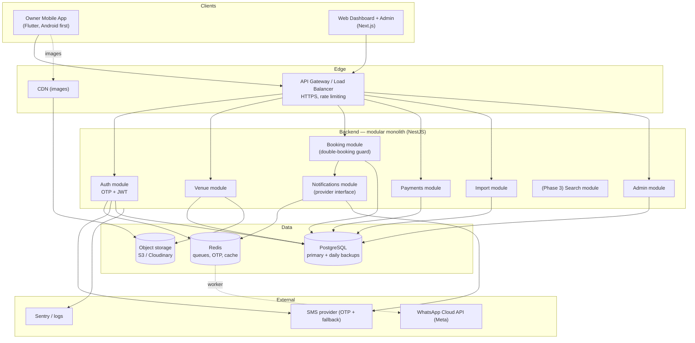

# Venue Booking Platform — Technical Plan & Architecture

> Owner-side MVP for event venues (wedding halls, banquets, marquees), Pakistan. Paper register → app + web dashboard. Consumer search is Phase 3.
> This document answers the brief's §15 ask for a tech approach + architecture, and resolves the §7/§14 open questions with recommended decisions (marked **DECISION** — confirm or override).

---

## 1. Design principles (what drives every choice)

1. **Double-booking must be impossible at the database layer**, not just in UI. The brief flags this twice as the #1 risk. We enforce it with a DB constraint, not application logic.
2. **Low-end Android first.** Light app, few network round-trips, small payloads, image compression on device.
3. **Modular monolith, Phase-3-ready.** Build a single backend now, but split domains (venues, bookings, payments, notifications, search) into clear modules so the consumer **search** service can be extracted later without a rewrite.
4. **Offline-capable architecture even though offline ships in Phase 2.** Every write is idempotent and carries a client-generated UUID, so we can add a sync queue later without changing the schema.
5. **WhatsApp is an external dependency that will change.** Isolate it behind a notification abstraction with a provider interface + a fallback channel.

---

## 2. System architecture



**Why a modular monolith, not microservices:** at MVP scale (10–15 pilot venues) microservices add ops cost with no benefit. Clear module boundaries + a clean DB give us 90% of the future-proofing at 10% of the complexity. Phase 3 search becomes a read-mostly service on the same DB (or a read replica / search index), extractable later.

---

## 3. Tech stack — decisions and reasoning

| Layer | Choice | Why |
|---|---|---|
| **Mobile app** | **Flutter** | Single Android codebase now, iOS later with the same code. Better rendering performance and consistency on cheap/old Android than RN; excellent **RTL + Urdu font** support out of the box. |
| **Web dashboard + admin** | **Next.js (React)** | One framework for owner web dashboard and internal admin. SSR/SEO matters later for the Phase 3 consumer site — same framework carries over. |
| **Backend** | **Node.js + NestJS**, REST | NestJS gives enforced modularity (the key architectural requirement) and first-class TypeScript shared with the Next.js side. Laravel is a fine alternative if the team is PHP-strong — the architecture below is framework-agnostic. |
| **Database** | **PostgreSQL** | **Non-negotiable over MySQL** because the double-booking guarantee uses PostgreSQL's `EXCLUDE` constraint + `btree_gist` — the cleanest, race-proof way to prevent overlapping bookings (see §5). |
| **Cache / queue / OTP store** | **Redis** | OTP codes (TTL), rate limiting, and the async job queue for WhatsApp/SMS so a slow Meta API never blocks a booking save. |
| **Object storage** | **S3-compatible (or Cloudinary)** + CDN | Venue photos. Cloudinary if we want auto-compression/transforms without building it. |
| **Notifications** | **WhatsApp Business Cloud API (Meta)** + SMS provider | WhatsApp for confirmations/reminders; SMS for OTP and fallback. Behind a provider interface. |
| **Hosting** | Cloud (DigitalOcean / AWS / GCP), **separate staging & production** | Region close to Pakistan for latency; managed Postgres with automated daily backups + PITR. |
| **Observability** | **Sentry** + structured logs | Error tracking from day one; the brief lists it. |
| **Delivery** | Git + PR review + CI/CD, secrets in env/secret manager | Standard. |

**DECISION — language/stack:** Flutter + NestJS + PostgreSQL. Override only if your team's existing strength dictates otherwise (e.g., Laravel). The DB choice (Postgres) should **not** change — it's load-bearing for correctness.

---

## 4. Data model

Core schema (field names ≈ brief §6, with corrections). **Money stored as integer paisa** (never float). **Phones in E.164.** Every write-entity carries a `client_uuid` for idempotency/offline-sync readiness.

```
User(id, phone[E.164, unique], name, role[owner|manager|admin], language, created_at)
Venue(id, owner_id→User, name, city, area, address, lat, lng,
      capacity_min, capacity_max, facilities JSONB, verified, status, created_at)
Hall(id, venue_id→Venue, name, capacity)          -- see DECISION below
Slot(id, venue_id→Venue, name, code)              -- configurable per venue; default Lunch, Dinner
RatePlan(id, venue_id→Venue, event_type, per_head_rate_paisa, notes)
Booking(id, client_uuid[unique], venue_id, hall_id, customer_name, customer_phone[E.164],
        event_type, event_date[DATE], slot_id, guest_count,
        total_amount_paisa, status[tentative|confirmed|completed|cancelled],
        tentative_valid_till[DATE null], cancel_reason, notes,
        created_by→User, created_at, updated_at)
Payment(id, booking_id→Booking, amount_paisa, paid_on, method[cash|bank|cheque|other], note, created_by)
Block(id, venue_id, hall_id, block_date[DATE], slot_id, reason)
Media(id, venue_id, url, type, sort_order)
NotificationLog(id, booking_id, channel[whatsapp|sms], template, status[queued|sent|delivered|failed], provider_msg_id, sent_at)
AuditLog(id, actor_id→User, entity, entity_id, action, before JSONB, after JSONB, at)
```

Derived (not stored): `paid = Σ Payment.amount`, `balance = total_amount − paid`. Compute in a view/query, don't denormalize for MVP.

**DECISION — Hall entity (brief §14):** **Include `Hall` as a first-class table now**, with a default "Main Hall" auto-created for single-hall venues. Reason: the double-booking constraint keys on `(hall_id, date, slot)`. Multi-hall marquees/banquets are common, and retrofitting a hall dimension into the uniqueness rule later is painful. Cost is tiny (one FK). The app hides hall selection when a venue has only one hall.

**DECISION — slots (brief §7/§14):** **Configurable slots per venue**, seeded with defaults **Lunch** and **Dinner**. Day bookings use a single "Full Day" slot that conflicts with both (handled as an overlap range — see §5). Flexible enough for every venue, simple default for most.

**DECISION — pricing (brief §14):** **Store both** — a `RatePlan.per_head_rate` for quoting + `guest_count`, and a final `Booking.total_amount` that the owner can override. Covers per-head, total-package, and "negotiated a flat number" cases without forcing a model on the owner.

---

## 5. Double-booking: the correctness core

This is the feature that must never fail. Three layers, strongest first.

### 5.1 Database constraint (the real guarantee)

A confirmed booking and a block occupy a `(hall, date, slot-range)`. We model a slot as a time range and use a PostgreSQL **exclusion constraint** so the DB itself rejects any overlap — even under concurrent transactions.

```sql
CREATE EXTENSION IF NOT EXISTS btree_gist;

-- one row per occupied slot; feeds from confirmed bookings and blocks
CREATE TABLE occupancy (
    id            bigserial PRIMARY KEY,
    hall_id       bigint NOT NULL REFERENCES hall(id),
    event_date    date   NOT NULL,
    slot_range    int4range NOT NULL,        -- e.g. Lunch=[1,2), Dinner=[2,3), FullDay=[1,3)
    source_type   text   NOT NULL,           -- 'booking' | 'block'
    source_id     bigint NOT NULL,
    EXCLUDE USING gist (
        hall_id   WITH =,
        event_date WITH =,
        slot_range WITH &&                    -- && = ranges overlap
    )
);
```

Any attempt to insert an overlapping confirmed occupancy for the same hall+date **fails at commit** with a constraint violation — two concurrent requests cannot both win. This is the "database-level constraint" the brief §7 asks for, and it also covers the "Full Day vs Lunch/Dinner" overlap correctly because `[1,3)` overlaps both `[1,2)` and `[2,3)`.

- **Tentative** bookings do **not** write to `occupancy` → they only trigger a UI warning, never block (matches the rule: tentative allowed with warning).
- **Confirm** a booking → insert its occupancy row in the same transaction; on conflict, return a clean `409 BOOKING_CONFLICT`.
- **Cancel/complete** → remove/adjust occupancy.

### 5.2 Application transaction

Confirm flow runs in a single `SERIALIZABLE`-safe transaction: re-check availability → insert occupancy → update booking status → enqueue WhatsApp. If the exclusion constraint throws, roll back and surface the conflict.

### 5.3 UI guard

On date/slot selection the app calls `GET /venues/{id}/availability` and shows busy state before the owner even fills the form — fast feedback, but it is **advisory only**; the DB constraint is the source of truth.

**Idempotency:** every booking create carries `client_uuid` (unique). A retried request (flaky network on a cheap phone) returns the existing booking instead of creating a duplicate.

---

## 6. Authentication

- **Phone + OTP.** OTP generated server-side, stored in Redis with short TTL + attempt counter (rate-limited to stop SMS-bombing).
- Delivery: **SMS for OTP** (reliable for login) — WhatsApp OTP optional later. **DECISION — §14 provider:** use an SMS aggregator with Pakistan coverage; keep it behind the same notification provider interface so it's swappable. (Shortlist to confirm with client's budget.)
- Session: short-lived **JWT access token + refresh token**. Refresh rotation.
- A `User` can be linked to **one or more venues** (join table `venue_user`), supporting the owner/manager share and future staff accounts (Phase 2) without schema change.
- Role-based access: `owner`, `manager`, `admin`. Admin actions on an owner's data always write `AuditLog`.

---

## 7. WhatsApp / notifications design

Isolate Meta behind an interface so template/policy churn and provider swaps don't ripple into booking logic.

```
interface NotificationProvider {
  send(to: E164, template: TemplateId, params: Record): Promise<ProviderResult>
}
```

- **Async via Redis queue + worker.** Booking save never waits on Meta. Worker sends, writes `NotificationLog` (queued→sent→delivered/failed), retries with backoff.
- **Templates** pre-approved in Meta Business Manager: confirmation, 7-day reminder, 1-day reminder, payment reminder. Reminders scheduled via a daily cron that scans upcoming bookings + outstanding balances.
- **24-hour window / template rules / pricing change** — the brief rightly warns Meta's rules shift. We only send **template messages** (allowed outside the 24h window), and verify current Meta docs at build start. Keep a config for template names so approvals can change without a deploy.
- **Fallback (brief open question):** if WhatsApp send fails after retries → **SMS fallback** + an in-app flag on the booking. **DECISION:** SMS fallback on, in-app always shows delivery status from `NotificationLog`.
- **BSP vs direct Meta (§14):** start **direct Meta Cloud API** (lower per-message cost, no middleman); the provider interface means moving to a BSP later is a config change, not a rewrite.

---

## 8. API surface (REST, versioned `/v1`)

Matches brief §10, with availability + idempotency added.

```
POST   /v1/auth/otp/request            {phone}
POST   /v1/auth/otp/verify             {phone, code} -> {access, refresh}
POST   /v1/auth/refresh

GET    /v1/venues                       (owner's venues)
POST   /v1/venues
GET    /v1/venues/{id}
PATCH  /v1/venues/{id}
GET    /v1/venues/{id}/calendar?from=&to=
GET    /v1/venues/{id}/availability?date=&slot=&hall=   -> busy/free (advisory)

POST   /v1/venues/{id}/bookings         {client_uuid, ...}   (idempotent)
GET    /v1/bookings/{id}
PATCH  /v1/bookings/{id}
POST   /v1/bookings/{id}/confirm        -> 200 | 409 BOOKING_CONFLICT
POST   /v1/bookings/{id}/cancel         {reason}

POST   /v1/bookings/{id}/payments       {amount, method, paid_on}
GET    /v1/bookings/{id}/payments

POST   /v1/venues/{id}/blocks
DELETE /v1/blocks/{id}

POST   /v1/venues/{id}/import           (bulk CSV/quick-entry)

# Admin
GET    /v1/admin/venues
PATCH  /v1/admin/venues/{id}/verify
GET    /v1/admin/stats
```

Conventions: clear error codes (esp. `BOOKING_CONFLICT`), consistent money-as-integer-paisa, all timestamps UTC, business dates in **Asia/Karachi**.

---

## 9. Non-functional implementation

- **Low-end Android:** compress/resize images on device before upload; paginate calendar by month; cache venue profile + current month locally; avoid heavy animations.
- **i18n / RTL:** Urdu (RTL) + English, Roman Urdu where needed. Flutter `Directionality` + a Naskh/Nastaliq font bundle (design team picks). All strings externalized from day one.
- **Reliability:** managed Postgres, **automated daily backups + point-in-time recovery**; booking writes are the highest-durability path.
- **Security:** HTTPS only, JWT, RBAC, rate limiting (auth + OTP), server-side input validation, signed upload URLs, secrets in a secret manager.
- **Privacy:** customer phone + wedding details are sensitive — collect only what's needed, owner consent + privacy policy (brief flags legal review; keep PII minimal and access-logged).
- **Offline (Phase 2, architected now):** idempotent `client_uuid` writes + a server "last-write-wins with conflict surfacing" rule mean a client sync queue can be bolted on later with no schema break. We do **not** build sync in MVP.

---

## 10. Phase 3 (consumer search) readiness — what we do now for free

- Keep **search-relevant fields clean and structured** on `Venue` (city, area, lat/lng, capacity, facilities JSONB, verified).
- Expose venue data through a **read-model/service boundary** (the Venue module), so a public search API can read without touching owner-write paths.
- Public search will be **read-mostly** → can run off a read replica or a search index (Postgres full-text first, Elastic/Meilisearch only if needed). No consumer tables are needed in MVP, but availability data is already query-ready via `occupancy`.
- Next.js on the web side means the eventual SEO consumer site reuses the same framework and component library.

---

## 11. Risks & mitigations

| Risk | Impact | Mitigation |
|---|---|---|
| **Double-booking under concurrency** | Trust-killing | Postgres `EXCLUDE` constraint + serializable confirm txn + idempotent writes. Load/concurrency test in acceptance. |
| **WhatsApp policy/pricing change (Meta)** | Notifications break or cost spikes | Provider interface, template-name config, SMS/in-app fallback, verify Meta docs at build start. |
| **Cheap-Android performance** | Owners abandon app | Flutter, on-device image compression, light payloads, real-device testing on low-RAM phones. |
| **Flaky networks → duplicate/lost writes** | Data integrity | `client_uuid` idempotency; retries safe. |
| **OTP/SMS deliverability in Pakistan** | Login friction | Choose a PK-strong SMS aggregator; rate-limit; WhatsApp OTP as secondary later. |
| **Data loss** | Catastrophic | Managed Postgres, daily backup + PITR, audit log. |
| **Scope creep from "nice-to-haves"** | Timeline slip | MVP line in §2 is firm; everything else Phase 2/3. |

---

## 12. Open questions resolved (brief §14) — confirm or override

| # | Question | Recommended decision |
|---|---|---|
| 1 | Slots fixed or configurable? | **Configurable per venue**, default Lunch + Dinner + Full Day |
| 2 | Hall entity in MVP? | **Yes**, with auto "Main Hall" for single-hall venues |
| 3 | Pricing model? | **Store both** per-head rate + editable final total |
| 4 | OTP/SMS provider? | SMS aggregator with PK coverage, behind provider interface (shortlist to confirm) |
| 5 | WhatsApp via Meta or BSP? | **Direct Meta Cloud API**; BSP later is config-only |
| 6 | Customer booking-view link? | Not in MVP; a tokenized read-only link is easy to add later (no schema change) |
| 7 | iOS in MVP? | **Android only** in MVP; Flutter makes iOS a later build, not a rewrite |
| 8 | Hosting region + backup? | Cloud region nearest PK; managed Postgres, daily backup + PITR |
| 9 | Owner data export? | CSV export of their bookings/payments — small, include in admin/owner settings |
| 10 | Name/branding | Product/design decision — out of technical scope |

---

## 13. Build sequence (maps to brief §12 milestones)

- **M0 (1–2 wk):** repo, CI/CD, staging, DB schema + exclusion constraint, auth skeleton, design handoff.
- **M1 (3–4 wk):** auth (OTP), venue profile + media, calendar, booking create/edit/cancel, **double-booking guard end-to-end**.
- **M2 (2–3 wk):** payments record + balances, WhatsApp confirmation + reminders (queue + worker + templates), SMS fallback.
- **M3 (2 wk):** admin panel (verify/suspend, bookings-on-behalf + audit), bulk import, analytics events.
- **M4 (2–3 wk):** pilot with 10–15 venues, concurrency/perf testing on real low-end devices, bug-fix + feedback.

Critical path item to start earliest: the **occupancy/exclusion-constraint design** and **WhatsApp template approval** (Meta approval has lead time).

---

*Next: say the word and I'll turn any section into (a) the full SQL migration for the schema + exclusion constraint, (b) a one-page client-facing version of this plan, or (c) the §15 proposal response with estimate + pricing.*
